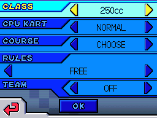

# Mario Kart DS Modding Trove

A public-toolchain framework for Mario Kart DS mods, with pieces that are useful outside MKDS too. Maintained by [GolyBidoof](https://github.com/GolyBidoof).

## What you can reuse

- **Mod framework:** independent NCPatcher-based mods, with BMG label planning, conflict checks and autoload-aware verification.
- **Nitro/BMG tools:** NDS header/FNT/FAT, BLZ, NARC/CARC, LZ77 and BMG repair/append code in `tools/`.
- **C headers:** matching NDS, NARC, BLZ and BMG declarations in `include/nitro/`.
- **Debug layer:** GDB RSP transport, persistent proxy, scripted MKDS navigation and screenshots. The generic layer works with [melonDS](https://github.com/melonDS-emu/melonDS) and the [DS-Kart-Recompiled](https://github.com/AlonsoTlol/DS-Kart-Recompiled) static recompiler.
- **Research:** format notes and MKDS table observations in `docs/`.

No ROM files or internal game files are stored here. Use a ROM you legally own. Mario Kart DS and Nintendo DS are trademarks of Nintendo; this project is not affiliated with or endorsed by Nintendo.

## AI disclosure

Substantial portions of the code, tests, documentation and patch templates were drafted or rewritten with generative AI under human direction and review. AI systems are tools, not authors; the maintainer is credited below. The patches are structurally verified but not correctness-guaranteed, so review and test before use.

## Quick start

```sh
python3 apply.py /path/to/game.nds
```

The patched ROM is written to `out/`. Wrappers: `run.command` on macOS, `run.sh` on Linux, `run.bat` on Windows. Run `python3 bootstrap.py --check` to inspect the toolchain. First run builds NCPatcher and downloads GNU Arm GCC if needed.

The patches use pattern detection, so stock EU, US and JP layouts are recognized. They can also apply over an already-modded ROM when the engine switch is already redirected. The verifier is structural, not a runtime test.

## Mods

This repository currently ships **one mod**. The 200cc, 250cc and 300cc choices are class options inside it, not separate mods.

| id | name | scope | screenshot |
|---|---|---|---|
| [`options-cc`](mods/options-cc/README.md) | Options class row: 200/250/300cc | Appends 200cc, 250cc and 300cc to the Options/VS-rules class row, localizes the names in the ROM's BMGs, and extends the engine CC switch on stock EU/US/JP images. |  |

The screenshot shows game content © Nintendo and documents the patch only.

## Documentation and development

The [format notes](docs/README.md) cover Nitro/NDS filesystems, BLZ, NARC/CARC, LZ77, BMG banks, ARM9 autoloads and the Options class row. The [debug-layer map](debug/README.md) covers recomp, melonDS, GDB/Ghidra and the shared MKDS layer. See [CONTRIBUTING.md](CONTRIBUTING.md) for where new findings, headers, tools, mods and routes belong.

Development needs Python 3.9+ and `arm-none-eabi-gcc` via `PATH`, `DEVKITARM`/`DEVKITPRO` or `ARM_GCC`/`ARM_TOOLCHAIN`. Patch units target the retail ARM9: use NCPatcher's `ncp.h` and `<stdint.h>`, not libnds headers.

Run `python3 -m unittest discover -s tests`; CI covers Python 3.9 and 3.12.

## Ecosystem

- [NCPatcher](https://github.com/TheGameratorT/NCPatcher) — ROM/archive patching and patch build pipeline, by [TheGameratorT](https://github.com/TheGameratorT).
- [Mario Kart Toolbox](https://github.com/HaroohiePals/MarioKartToolbox) — archive/BMG data model, by [HaroohiePals](https://github.com/HaroohiePals).
- [melonDS](https://github.com/melonDS-emu/melonDS) — emulator and GDB stub compatibility.
- [DS-Kart-Recompiled](https://github.com/AlonsoTlol/DS-Kart-Recompiled) — static recompilation and origin of the debug layer, by [AlonsoTlol](https://github.com/AlonsoTlol).
- [Ghidra](https://ghidra-sre.org/) — optional live GDB debugger.
- [GBATEK](https://problemkaputt.de/gbatek.htm) — NDS hardware and format reference, by Martin Korth.
- [ndstool](https://github.com/devkitPro/ndstool) — Nitro filesystem tooling, by devkitPro.

Full tool licences, format references and debug provenance are in [CREDITS.md](CREDITS.md). The project is MIT-licensed; third-party notices are in `LICENSES/`.
