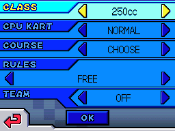

# options-cc

> **Project:** Mario Kart DS Modding Trove · **Mod:** `options-cc` · **Licence:** MIT

Appends **200cc / 250cc / 300cc** to the Mario Kart DS **Options** class row (the VS-rules list). It does not touch the 2×2 GP class-select tiles.

The lower screen in VS Rules with `CLASS` focused on `250cc`:

The screenshot shows game content © Nintendo and is included only to document the patch; it is not MIT-licensed code.

## What it does

- Options CLASS row: 4 → 7 entries.
- Option→CC, CC→option and CC→unlock tables extended.
- Mirror moves from option 3 to option 6.
- `200cc`, `250cc`, `300cc` appended to every `Menu*/rule.bmg` the ROM ships, with per-language labels (`200 cc` in Spanish, `200 ccm` in German).
- On MKDS (E), (U), and (J) ROMs and compatible custom distributions, the engine CC switch is extended so the new modes scale speed and drift. On an already-modded image whose switch is already redirected, the engine source is skipped (`"when": {"engine_mode": "patch"}` in `mod.json`) and only the Options/BMG patches apply.

## Engine values

`engine.json` stores max speed as decimal floats (`0.7` = 70%, `1.0` = 100%) and drift as the integer added to `->drift`. The tool converts max speed to Q12 (`4096 = 1.0`) for the ARM patch; the ARM9 has no FPU, so the emitted code uses integers. The C header exposes the speeds as EABI `float` (`mkds_f32`) and provides `MKDS_Q12()`. Drift is not Q12; it is the game's field unit.

## BMG messages

The labels are in `messages/` and are selected by the archive language:

| Archives | Labels |
|---|---|
| default, `Menu_us`, `Menu_fr`, `Menu_it`, `Menu_ja` | `200cc`, `250cc`, `300cc` |
| `Menu_es` | `200 cc`, `250 cc`, `300 cc` |
| `Menu_ge` | `200 ccm`, `250 ccm`, `300 ccm` |

The stock labels are `50 cc` in Spanish and `50 ccm` in German, so the new labels match each language. `MenuDL_*` variants use the same language. The tool reads the ROM's own message data, strips earlier copies of the labels, and appends them at ids 24-26 (the first free ids in the stock 24-message banks). No internal game files are stored in the repo.

## Compatibility

Compatible with MKDS (E), (U), and (J) ROMs and custom distributions that retain the stock Options layout, including already-modded `.nds` files. The existing engine redirect on a pre-modded image is left byte-identical.

## Files

- `mod.json` — what the mod contributes (sources, BMG labels, verifier).
- `profile.py` — scans the input ARM9 for the Options/engine sites and returns the addresses used by the templates.
- `engine.json` — engine values: max speed as decimal floats and drift as integer deltas.
- `source/options_class_row.h.tmpl` — MKDS message ids, CC modes and the `MKDS_Q12` helper shared by the C header.
- `source/options.h.tmpl` — addresses, appended message ids and includes `options_class_row.h`.
- `source/options.c.tmpl` — tables and patches; includes `options.h`.
- `source/engine.s.tmpl` — readable ARM assembly template for the stock switch.
- `messages/` — per-language BMG labels.
- `verify.py` — checks the output after patching.

`{{...}}` placeholders are filled by `tools/patch.py` from the ROM profile and from the ids the BMG planner assigned to this mod's labels. The renderer writes each mod to its own `source/<mod id>/` directory, so `options.c` includes the local `options.h` directly. Edit the templates directly; no generated source lives in the repo.

## Table layout

The Options row is driven by these stock ARM9 addresses (found by pattern, not by a symbol file):

| Purpose | Placeholder |
|---|---|
| uint16_t CLASS row option count | `{{profile.row_count}}` |
| literal word → CLASS message ids | `{{profile.msg_ptr}}` |
| literal word → option→CC table | `{{profile.option_to_cc}}` |
| literal word → CC→option table | `{{profile.cc_to_option}}` |
| literal words → unlock category | `{{profile.unlock_a}}`, `{{profile.unlock_b}}` |
| Mirror instruction sites | `{{profile.mirror_load}}`, `{{profile.mirror_compare}}` |

The engine source additionally uses `{{profile.engine_hook}}`, `{{profile.engine_config}}` and `{{profile.engine_resume}}`.

## Independence

The mod only touches the stock Options addresses and the labels it names. The framework rejects a run where another selected mod patches one of the same addresses or appends one of the same BMG labels.
